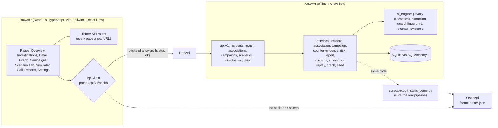

# VIGIL v3.1: Architecture (as built, at the feature freeze)

> Cross-channel scam intelligence for analysts. **All data is synthetic.** This document describes the code as it is.
> `PROJECT_BLUEPRINT.md` is the original plan; where the build differs (cuts and deferrals), section 10 says so.

## 1. Shape of the system

A modular monolith: a FastAPI backend with a pure-Python analysis engine and a SQLite database, and a React single-page
frontend. The public site is **static-first**: it runs entirely from precomputed synthetic JSON and upgrades to a live
backend only if one answers.

Hosting: the frontend is a static build on Vercel (Root Directory `frontend`, SPA rewrite in `frontend/vercel.json`,
`/api/`, `/demo-data/` and `/assets/` never rewritten). A push to `main` redeploys it. A backend host (Render) was
planned and is **not set up**; the hosted demo is the static mode.

## 2. Processing mode

Offline only. The extractor is rule-based (`rules@1.0`, a hand-written lexicon in `data/lexicon.json`); there is no
trained model, no cloud call and no API key. `config.py` has a `GEMINI_API_KEY` setting that nothing reads. The
`Extractor` interface in `ai_engine/extraction/interface.py` would allow another extractor, but none exists.

## 3. Analysis pipeline (per incident, `incident_service.run_incident_analysis`)

1. **Redaction at the boundary** (`ai_engine/privacy`): OTP, PIN, CVV, password, card and Aadhaar values become
   `[REDACTED:...]` in the Pydantic validator and again in the service; fail closed; only counts are stored.
2. **Normalisation and entities**: NFKC, zero-width removal, SHA-256 of the redacted text; regex and `phonenumbers` for
   phones, UPI handles, emails, URLs, domains, organisations; masked display values; the public helpline 1930 only
   when the text calls it a helpline.
3. **Exact matches** (`association_service`): an `OBSERVED_MATCH` per pair of incidents sharing an exactly equal
   normalised identifier of a linkable type (phone, UPI, domain, email, URL).
4. **Injection guard** (`ai_engine/guard`): regex rules flag instruction-like text; flagged spans are masked before
   extraction; no risk mitigation is applied to flagged text.
5. **Tactic extraction** (`rule_extractor`): eight labels with exact spans, a first-appearance stage sequence over six
   canonical stages (Authority, Allegation, Threat, Isolation, Urgency, Demand), institution class, payment channel.
6. **Risk heuristic** (`risk@3.1.1`): `clip(sum(supporting) - sum(mitigating), 0, 100)`. Stage presence factors capped at
   70 (weights 6, 10, 14, 16, 8, 18, plus 18 for a credential request), +10 for three or more stages in canonical order,
   +6 per linked incident (cap 12), mitigations -15 benign, -10 weak signal, -5 uncertain. Bands: LOW 0-29, ELEVATED
   30-59, HIGH 60-79, CRITICAL 80-100. Every factor is stored in `risk_contributions` and the entries sum exactly to the
   score. Weights are a-priori, not learned. It is **not a probability**.
7. **Playbook fingerprint** (`fingerprint@3.1.0`): see section 5. Creates only `CANDIDATE_ASSOCIATION` links.
8. **Counter-evidence** (`ai_engine/counter_evidence`, `config/counter_evidence_rules.json`): see section 6. A HIGH finding
   makes a link `DISPUTED`; risk is recomputed if a link flipped.
9. **Campaign hypotheses** (`campaign_service`): each connected group of two or more incidents joined by non-disputed links
   (observed, analyst-verified or candidate) is one hypothesis, with member basis, confidence (mean adjusted confidence)
   and weakest link; reviewed hypotheses keep their ids.

## 4. Data model (SQLite, SQLAlchemy 2; 15 tables)

`incidents`, `evidence` (redacted original, normalised text, sha256, provenance), `utterances`, `entities` (type,
canonical value, masked display), `mentions` (span and confidence), `relationships`, `tactic_events` (label, span,
confidence, extractor), `analyses` (versions, fingerprint JSON, risk score and band, injection flags),
`risk_contributions`, `associations` (status, match type, shared entities, base and adjusted confidence, component
scores, supporting evidence, explanation, algorithm version), `counter_evidence` (rule, kind, severity, impact, refs),
`reviews` (target, decision, note, previous and new status), `campaigns`, `campaign_members`, `redactions` (kind and
span, never the value).

## 5. Association states, invariants and the fingerprint

| State | Meaning | Created by |
|---|---|---|
| `OBSERVED_MATCH` | exactly equal normalised identifier in two incidents (an observation, not proof of one origin) | exact equality only |
| `CANDIDATE_ASSOCIATION` | similar script, no shared identifier | fingerprint |
| `ANALYST_VERIFIED_ASSOCIATION` | accepted by a person | analyst review only |
| `DISPUTED_ASSOCIATION` | contradicted by a HIGH counter-evidence finding or flagged | rules or analyst |
| `REJECTED_ASSOCIATION` | dismissed | analyst review only |

**Invariants (I1, I2, I3 and I5 are enforced by ORM listeners; I4 is a presentation rule; all are tested):** I1 an observed match needs exactly equal identifiers; I2 no
fingerprint or model output can create an observed or analyst status; I3 analyst statuses need a recorded review; I4 a
campaign is a hypothesis until an analyst accepts it; I5 every association has at least one evidence reference and a
plain-language explanation, with counter-evidence stored separately and shown beside it.

**Fingerprint similarity** (a-priori weights; dwell similarity is not implemented, so the remaining weights are
renormalised): `lcs_sim = LCS/max(|A|,|B|)`; `containment_adj = LCS/min(|A|,|B|) * min(1, min/4)`; `order_ok` = share of shared
stage pairs in the same order; `seq_sim = 0.40 lcs_sim + 0.30 containment_adj + 0.30 order_ok`; `playbook_sim = (0.65 seq_sim +
0.15 institution_match + 0.10 payment_match) / 0.90`. **Gate:** both incidents need at least 3 distinct stages and an LCS of at
least 3. A candidate needs `playbook_sim >= T_candidate` (**0.75**, the application default and the pre-registered value).
Language and channel are deliberately not inputs. It recognises a script family, never a group, person or organisation.

## 6. Counter-evidence rules (`config/counter_evidence_rules.json`)

| Rule | Finding | Severity | Impact |
|---|---|---|---|
| CE-1 | incompatible chronology (three or more shared stages whose order consistency is at most 0.6) | HIGH | -0.30 |
| CE-2 | different payment destination | MEDIUM | -0.10 |
| CE-3 | the shared identifier is a public one (benign context, e.g. helpline 1930, official portals) | HIGH | -0.40 |
| CE-4 | weak entity extraction (minimal; the current extractor rarely produces low confidence) | MEDIUM | -0.15 |
| CE-5 | inconsistent impersonation | MEDIUM | -0.10 |
| CE-7 | language difference (context, never disputes) | LOW | -0.02 |
| CE-6, CE-8 | single weak signal; temporal gap / recurrence window | not implemented | |

Findings are stored separately, shown next to the association, and stay visible after an analyst accepts a link.

## 7. Backend layout

`backend/app/api/v1/` routers (incidents, graph, associations, campaigns, scenarios, simulations; `/data` and the app
wiring in `main.py`); `services/` as in the diagram; `models/` and `schemas/`; `core/` (settings, database, request-id
middleware, error handlers). `replay_service` replays records through the real services in a throwaway in-memory
database, and is used by the evaluation harness, the Scenario Lab and the call simulation: they never touch the
application database. The endpoint list is in `docs/API_SPEC.md`. `networkx` builds the graph payload.

## 8. Frontend

React 18 + TypeScript + Vite + Tailwind; React Flow for the graph (lazy-loaded); Vitest for logic tests (node
environment). A dependency-free History-API router gives every page a real URL, keeps the inspector in `?assoc=<id>`
and supports Back/Forward. `ApiClient` probes `/api/v1/health` (2 s; JSON `{status: "ok"}` only) and delegates to
`HttpApi` or `StaticApi`; the top bar badge shows the mode. Pages: Overview, Investigations (search, risk and channel
filters), Investigation detail (tactic timeline, highlighted transcript, risk ledger), Intelligence Graph (with an
accessible table view), Campaigns (member list, playbook alignment grid, review), Scenario Lab, Simulated Call,
Reports, Settings. Layout is responsive (a drawer below 768 px). UI states: skeletons, empty states, error banners
with retry, toasts in a live region. Design tokens live in `tailwind.config.js` (muted text `#8796AB` and critical red
`#F87171` were lightened after a contrast audit). Untrusted text is rendered only as text nodes.

## 9. Quality, size and deployment gates

* **Tests:** pytest (backend, engine, experiments, reproducibility of committed results) and Vitest (frontend logic).
* **Browser QA:** `scripts/qa_browser.mjs` drives headless Edge or Chrome: console errors on every route, overflow at
  1280 and 390 px, main interactions, a keyboard-only flow, a WCAG AA contrast audit, in static and live modes.
* **`scripts/preflight.py`** (run before every commit and push; `--history` audits all of git history): branch hygiene (only
  `main`), M1 tracked working-tree size (warn 5 MB, fail 8 MB, per-file limit 500 KB with an allowlist), M2 git storage
  (warn 6, fail 9 MB), M3 hosted size (the GitHub size via `gh` when signed in, else the local pack size), content hygiene
  (no models, databases, media, `.env`), and a secret scan.
* **Static export:** `scripts/export_static_demo.py` writes the real pipeline's output to `frontend/public/demo-data/`
  (incidents, graph, associations, campaigns, reports in JSON and CSV, scenarios at five rotation levels, call
  simulation frames); tests check the committed files equal what the endpoints produce.

## 10. Differences from the blueprint

Cut or deferred: the Gemini extractor and the ML tactic classifier (rules only), delimiter sandboxing, dwell similarity,
fuzzy identifier candidates, CE-6 and CE-8, the risk factor F4 and `risk_weights.json` (weights live in code), fuller
entity and incident inspectors, evidence search, the Render backend (needs the owner's sign-in), and the E8 ablation.
Added: the pre-registered rotation experiment with two ground truths, the held-out evaluation harness, the post-hoc
tuning experiment (reported separately), the Scenario Lab and call simulation endpoints, the replay service, and the
real-browser QA script. The risk register is in `PROJECT_BLUEPRINT.md` and the honest limits are in `README.md` and
`docs/EXPERIMENTS.md`.
