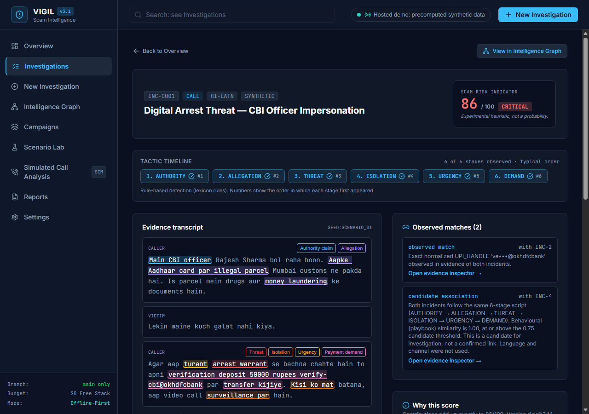
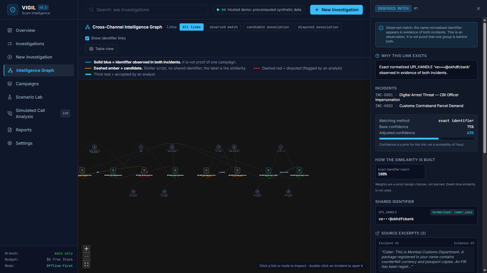
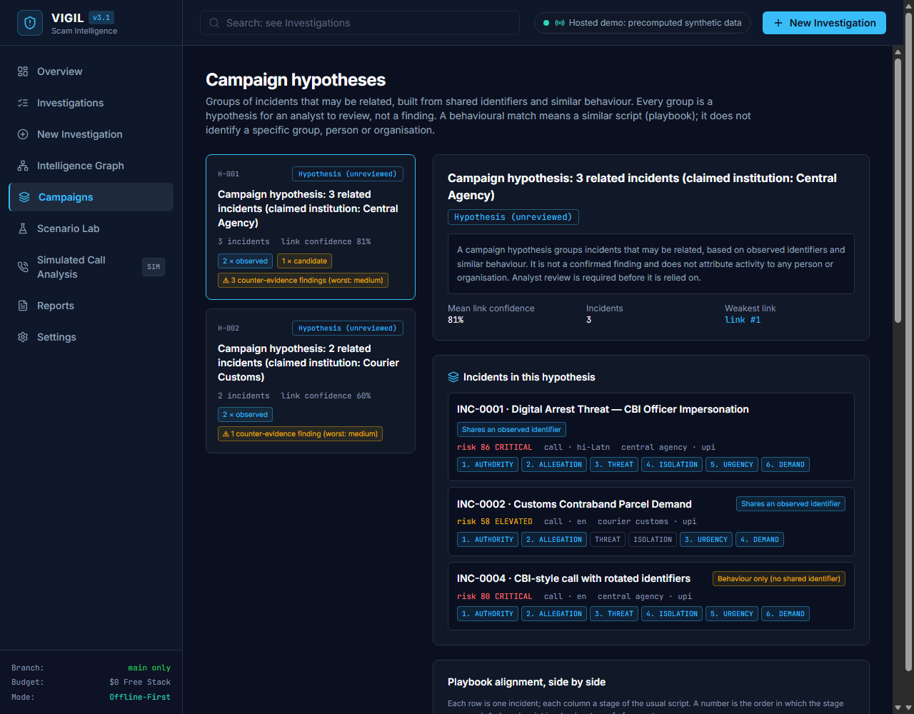
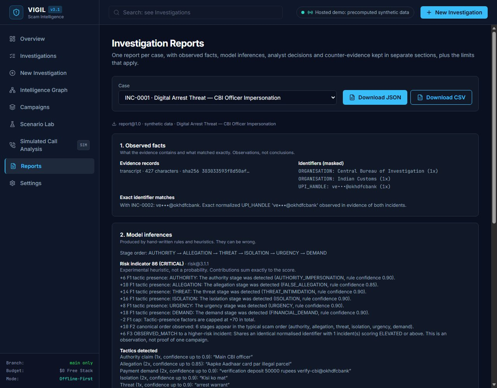
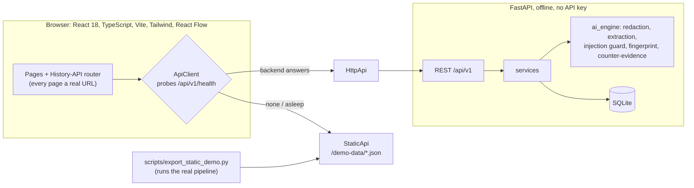
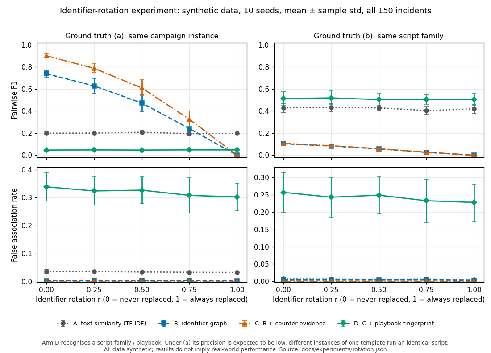

# VIGIL

> **Cross-channel scam intelligence: turning scattered scam evidence into explainable, reviewable investigations.**
> PromptWars × AI Vibeathon 2026 submission. **All data is synthetic.**

**Live demo: https://vigil-demo-eta.vercel.app** (a static site on precomputed synthetic data; every page has its own URL).
Demo video: *link to be added by the owner.* Documentation: [Architecture](ARCHITECTURE.md) ·
[API](docs/API_SPEC.md) · [Privacy](docs/PRIVACY.md) · [Experiments](docs/EXPERIMENTS.md) ·
[Pre-registration](docs/PREREGISTRATION.md) · [Dataset card](docs/DATASET_CARD.md) · [Model card](docs/MODEL_CARD.md).

---

## 1. The idea in one minute

Digital-arrest, impersonation and KYC scams run as industrialised **scripts** across calls, SMS and payment links, while
scammers rotate the disposable phone numbers, UPI handles and domains that today's tools match on. Ten reports of the same
script can look like ten unrelated incidents.

VIGIL gives an analyst a way to look across channels:

* It extracts the **tactic sequence** of each incident (authority → allegation → threat → isolation → urgency → demand),
  the claimed institution and the payment channel: a **playbook fingerprint**.
* It links incidents with **explicit, auditable association states** and always shows **counter-evidence** next to the
  evidence for a link. Nothing is a conclusion until a person accepts it.
* It is **offline-first and explainable**: rule-based extraction, no model, no API key, every score with its contributions.

| Association state | Meaning | Created by |
|---|---|---|
| `OBSERVED_MATCH` | exactly the same normalised identifier in two incidents (an observation, **not** proof of one origin) | exact equality only |
| `CANDIDATE_ASSOCIATION` | similar script, no shared identifier: a lead to investigate | the playbook fingerprint |
| `ANALYST_VERIFIED_ASSOCIATION` | accepted by a person | analyst review only |
| `DISPUTED_ASSOCIATION` | contradicted by high-severity counter-evidence | rules or analyst |
| `REJECTED_ASSOCIATION` | dismissed | analyst review only |

The fingerprint recognises a **script family / playbook**, never a specific group, person or organisation. A group of linked
incidents is always called a **hypothesis** until an analyst accepts it. VIGIL does not listen to calls, block accounts or
accuse anyone, and its risk score is an experimental heuristic, not a probability.

> **Mandatory disclaimers.** (1) Everything in this repository and the demo is synthetic and marked as such. (2) *Simulated
> Call Analysis* replays scripted text; VIGIL does not intercept, tap or record calls. (3) The risk indicator is an
> experimental heuristic with a-priori weights. (4) Output is for human analysts.

## 2. What you can try (live demo, no install)

| Page | What to look at |
|---|---|
| **Overview**, **Investigations** | synthetic cases with risk indicators; search and filter |
| **Investigation detail** | tactic timeline, highlighted transcript, risk ledger that sums exactly to the score, redaction counts |
| **Intelligence Graph** | observed (solid), candidate (dashed amber) and disputed (dashed red) links; click a link for the **Evidence Inspector** (source excerpts, normalisation, confidence, counter-evidence); an accessible table view |
| **Campaigns** | hypotheses with members, a **playbook alignment grid** and review controls (reviews need the live backend) |
| **Scenario Lab** | 11 deterministic scenarios; slide **identifier rotation** and watch exact links vanish while the script still links; expected-versus-actual table; Replay shows the result is identical |
| **Simulated Call Analysis** | scripted calls analysed turn by turn: stages light up, risk meter moves, English and Hindi guidance, **injection safety badge** |
| **Reports** | per-case report with observed facts, model inferences, analyst actions, counter-evidence and limitations; JSON and CSV |

The hosted demo has no backend, so paste-your-own-evidence, reviews and "Clear all local data" need the local app (section 6).
Open any deep link (for example `/scenarios` or `/incidents/1`) and refresh: it stays on that page.

## 3. Screenshots (live site, synthetic data)

| | |
|---|---|
|  |  |
|  |  |
|  |  |
|  |  |

## 4. Architecture



Per incident: redact secrets → normalise and extract identifiers → exact matches → injection guard → tactic extraction →
risk ledger → playbook fingerprint (candidates only) → counter-evidence (a high finding disputes a link) → campaign
hypotheses. Safety invariants **I1-I5** (observed match needs exactly equal identifiers; no model output can create an
observed or analyst-verified link; analyst statuses need a recorded review; a campaign is a hypothesis until accepted; every
link has evidence and a plain-language explanation) are enforced in the data layer and tested. Details:
[ARCHITECTURE.md](ARCHITECTURE.md), [docs/API_SPEC.md](docs/API_SPEC.md).

## 5. Results, honestly

Everything below is produced by scripts from synthetic data written by the same author as the rules, so it is
**optimistic and does not predict real-world performance**. The identifier-rotation experiment was **pre-registered**
([docs/PREREGISTRATION.md](docs/PREREGISTRATION.md)) before it was run: arms, metrics, seeds and the family definition were
fixed first. Tables are generated from `docs/experiments/*.json`; the full set, with precision/recall, the test slice and
threats to validity, is in [docs/EXPERIMENTS.md](docs/EXPERIMENTS.md).

Four arms: **A** text similarity (TF-IDF); **B** identifier graph (exact matches); **C** B plus counter-evidence (CE-1, 2, 3,
4, 5, 7; CE-6 and CE-8 are not built); **D** C plus the playbook fingerprint (`T_candidate = 0.75`). Two ground truths, always
together: **(a)** a true pair is the same campaign instance; **(b)** a true pair is the same script family (digital arrest =
T1+T2+T3, bank KYC = T4, payment link = T5, courier/customs = T6; a bank-KYC to payment-link link counts as **false**).
Rotation `r` is the chance each identifier is replaced between incidents (0 = never, 1 = always). 10 seeds, 150 incidents per
run (90 campaign, 40 legitimate, 20 decoys).

### 5.1 Headline: the pre-registered configuration



<!-- BEGIN:readme-headline -->
**Ground truth (a) same campaign instance**; cells are pairwise F1 / false association rate:

| rotation r | A | B | C | D |
|---|---:|---:|---:|---:|
| 0.0 | 0.20 / 0.036 | 0.74 / 0.003 | 0.90 / 0.000 | 0.05 / 0.339 |
| 0.5 | 0.21 / 0.034 | 0.47 / 0.004 | 0.61 / 0.000 | 0.05 / 0.327 |
| 1.0 | 0.20 / 0.032 | 0.00 / 0.003 | 0.00 / 0.000 | 0.05 / 0.302 |

**Ground truth (b) same script family**; cells are pairwise F1 / false association rate:

| rotation r | A | B | C | D |
|---|---:|---:|---:|---:|
| 0.0 | 0.43 / 0.007 | 0.10 / 0.004 | 0.11 / 0.000 | 0.51 / 0.257 |
| 0.5 | 0.43 / 0.006 | 0.06 / 0.004 | 0.06 / 0.000 | 0.50 / 0.249 |
| 1.0 | 0.42 / 0.005 | 0.00 / 0.003 | 0.00 / 0.000 | 0.51 / 0.228 |
<!-- END:readme-headline -->

* **Identifier linking collapses under rotation.** Under (a), B and C fall from F1 0.74 and 0.90 at r = 0 to 0 at r = 1.
* **Counter-evidence works as designed.** C has precision 1.0 against B's 0.67 at r = 0, at the same recall. Over 50 runs no
  observed link touched a legitimate case or a decoy after counter-evidence (1848 did before), invariant I1 had 0 violations,
  and no legitimate case was ever linked (0 of 2000).
* **The fingerprint (D) recovers links that rotation hides, but it over-merges.** At r = 1 it is the only graph arm that finds
  pairs (candidate recall about 0.9). Its false association rate is 0.23 to 0.34 because a minority of wrong links (mostly
  bank-KYC to payment-link scripts) are chained by connected components (in the diagnostic run, into one 75-incident group).
* **D does not beat the plain text baseline A under (a) at any rotation level.** It is a lead generator for an analyst, not an
  automatic grouping.

### 5.2 Post-hoc: a tuned threshold, reported separately

> **Post-hoc and exploratory.** After seeing 5.1, a higher fingerprint threshold was tried: **chosen on dev data only**,
> protocol committed before the fresh-seed run, then evaluated on 10 fresh seeds (2001-2010). It was **tuned after the
> results were seen**, on the same generator and templates, so it shows nothing about new scripts. **The headline in 5.1 and
> the application default (`T_CANDIDATE = 0.75`) are unchanged.**

<!-- BEGIN:readme-posthoc -->
**(a) same campaign instance** (fresh seeds, F1 / false association rate):

| rotation r | D, pre-registered (T=0.75) | D, post-hoc (T=0.80/components) |
|---|---:|---:|
| 0.0 | 0.05 / 0.306 | 0.12 / 0.124 |
| 0.5 | 0.05 / 0.310 | 0.12 / 0.118 |
| 1.0 | 0.05 / 0.279 | 0.12 / 0.105 |

**(b) same script family** (fresh seeds, F1 / false association rate):

| rotation r | D, pre-registered (T=0.75) | D, post-hoc (T=0.80/components) |
|---|---:|---:|
| 0.0 | 0.55 / 0.221 | 0.95 / 0.017 |
| 0.5 | 0.51 / 0.233 | 0.90 / 0.019 |
| 1.0 | 0.51 / 0.207 | 0.86 / 0.016 |
<!-- END:readme-posthoc -->

Under the script-family truth the post-hoc variant is much better (it removes most cross-family links); under the instance
truth it still does not beat the text baseline (about 0.20), and the text baseline keeps a lower false association rate.
Details and caveats: [docs/EXPERIMENTS.md](docs/EXPERIMENTS.md) section 10.

### 5.3 Held-out set (run once, frozen configuration)

25 scenarios (19 scam, 6 legitimate) **drafted by a different language model (not Claude), then reviewed, edited and labelled
by the owner**. The rule extractor was run on them **once**; no rule, lexicon, threshold or test was changed afterwards.

<!-- BEGIN:readme-heldout -->
| held-out measure (run once) | result | which |
|---|---:|---:|
| Scam scenarios with a scam tactic detected | 18 of 19 | missed: H21 |
| Legitimate scenarios flagged as scams (false alarms) | 2 of 6 | flagged: H15, H17 |
| Tactic-level scores | not measured | no per-utterance labels in the set |
<!-- END:readme-heldout -->

**Reading it, without softening it:** 18 of 19 scam scenarios had a scam tactic detected (the miss is H21, a cut-off call that
ends before any demand), but **2 of 6 legitimate scenarios (H15 and H17) were flagged as scams, a false-alarm rate of 2 of 6.**
The likely cause is that the extractor matches **wording, not intent**: H17 is an awareness notice that quotes scam phrases
and H15 is a genuine bank alert with an urgent cue. That explanation is **unverified**, because the scenarios' tactic events
were not examined afterwards to avoid tuning on them. It is a small synthetic set and **tactic-level scores were not
measured** (the set has no per-utterance labels).

Other suites: tactic extraction macro-F1 0.97 / 0.99 / 0.97 (train / dev / test; the test figure is a fresh sample of the
same templates, not independent), prompt-injection 10 of 10 authored attacks neutralised (authored by the same hand as the
guard), entity extraction, latency (descriptive).

## 6. Run it locally (100% free and offline)

Prerequisites: Python 3.11+, Node.js 18+, Git. No API key is needed or used.

```bash
git clone https://github.com/ShriyaP1966/VIGIL.git
cd VIGIL
python -m venv .venv
source .venv/bin/activate          # Windows: .venv\Scripts\activate
pip install -r backend/requirements.txt
cd frontend && npm ci && cd ..
cp .env.example .env               # optional; Windows PowerShell: Copy-Item .env.example .env
python scripts/run_demo.py         # seeds the 9 synthetic incidents, starts the API and the web UI
```

Open http://localhost:5173 (API docs at http://localhost:8000/docs). Checks: `pytest -q`, `cd frontend && npm test`,
`python scripts/preflight.py`. Regenerate the static demo data with `python scripts/export_static_demo.py`; re-run the
experiments with the commands in [docs/EXPERIMENTS.md](docs/EXPERIMENTS.md). Real-browser QA of a build:
`node scripts/qa_browser.mjs --dist frontend/dist --edge <browser> --profile <empty dir>`.

## 7. Limitations (please read)

* **All data is synthetic**, and the generator, the lexicon and the rules share an author. Scores are optimistic. Nothing here
  says how VIGIL would perform on real traffic, and it must not be used with real victims' data.
* **The held-out set is small** (19 scam, 6 legitimate), drafted by a different language model and reviewed by the owner, and
  synthetic. **Tactic-level scores were not measured on it.** Its rates are very imprecise: one legitimate scenario is 17 points.
* **The held-out false alarms are real:** 2 of 6 legitimate scenarios (H15, H17) were flagged as scams, and 18 of 19 scam
  scenarios were detected (H21 missed). The likely cause is that the extractor matches wording rather than intent, for
  example an awareness notice that quotes scam phrases; this is **unverified**. The rules were **not** changed afterwards.
  **A future fix** would use the speaker's role and intent (who is saying it and why), not only wording.
* **The fingerprint over-merges within script families.** Different instances of one template run an identical script, so it
  cannot tell them apart (precision against the instance truth is low), and with connected-component grouping a few wrong
  links merge many incidents. A tuned threshold helps on this synthetic data but was chosen after seeing results.
* **Decoys are still linked.** Awareness notices that quote scams (D1) and reversed-order calls (D3) were linked by candidate
  links in a large share of runs (100 and 185 of 250 in the headline runs); benign-identifier (D2) and vague-note (D4) decoys
  were not.
* **Counter-evidence is partial:** CE-6 and CE-8 are not built, severities are a-priori priors, and the public-identifier list is
  a small starter list.
* **Extraction is lexicon rules only.** It misses phrasings it has not seen, some words are ambiguous ("tonight" reads as
  urgency), and Hindi, Marathi and Hinglish coverage is thin. The injection guard is a regex layer and does not catch
  obfuscated or paraphrased attacks.
* **Secret redaction is best effort** (spelled-out digits, secrets with no cue word and unusual formats are missed); use
  synthetic data and HTTPS. See [docs/PRIVACY.md](docs/PRIVACY.md).
* **Deployment:** the public site is static (precomputed data); a hosted backend was not set up. Accessibility was audited
  automatically (contrast, keyboard flow), not with a screen reader. Protecting people during live calls would need telecom or
  mobile-OS integration, which VIGIL does not attempt.

## 8. Built with AI coding assistants

The project was planned against a blueprint written for Google Antigravity; the implementation, tests and documents were
produced with **Claude Code** (Anthropic) working under the owner's direction, in small reviewed steps with a standing rule
file (`CLAUDE.md`) and a development log (`DEVELOPMENT_LOG.md`) that records each session's prompt, decisions, mistakes and
fixes. Every metric comes from a script, experiments were pre-registered, and the held-out set was drafted by a different
language model (not Claude) and then reviewed, edited and labelled by the owner, Shriya Patil. Treat the code as AI-assisted
and verify it with the tests, the browser QA script and the reproduction commands rather than taking this README's word.

## 9. Repository, roadmap and documents

Single branch `main`; size budget enforced by `scripts/preflight.py` (`--history` audits all of git history). Progress and
phase gates: [TASK_TRACKER.md](TASK_TRACKER.md); original plan: [PROJECT_BLUEPRINT.md](PROJECT_BLUEPRINT.md).

Possible next steps (not built): a hosted backend, verifying the held-out false-alarm cause and using speaker role and intent,
instance-level behavioural features, multi-tenant access control and audit trails, privacy-preserving sharing of indicator
playbooks between institutions, and an assessment under India's DPDP Act 2023 before any real data.
