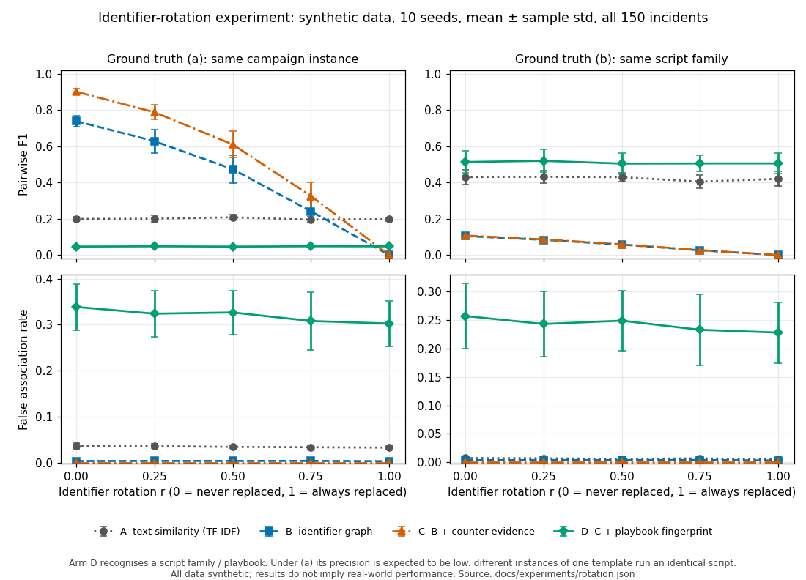

# Experiments (Phase 5)

Every number in the tables below is generated from `docs/experiments/*.json` by
`scripts/render_experiment_tables.py`, and a test fails if the tables and the JSON disagree. The experiments were
**pre-registered** in `docs/PREREGISTRATION.md` (committed before any E3 or E4 run). Nothing was tuned on a
result, and a low result is reported as a low result.

**All data is synthetic**, and the generator, the lexicon and the rules share an author. These numbers describe
how the pipeline behaves on this generator's data. They do not predict performance on real traffic. The playbook
fingerprint recognises a **script family / playbook**, never a specific group, person or organisation.

## 1. The short version



What the identifier-rotation experiment (E4) shows, in plain words:

1. **Identifier linking collapses as scammers rotate identifiers.** Under the campaign-instance truth (a), the
   identifier graph (B) and the identifier graph with counter-evidence (C) fall from F1 0.74 and 0.90 at r = 0 to 0
   at r = 1. This is the problem the project set out to show.
2. **Counter-evidence does what it was built to do.** C has the same recall as B but precision 1.0 at r = 0 (B: 0.67),
   because the benign-identifier rule (CE-3) disputes the links created by notices that merely cite the same
   public helpline. After counter-evidence no link touches a legitimate negative or a decoy (E3), and identifier
   links that touched one before counter-evidence numbered 1848 over the 50 runs.
3. **The playbook fingerprint (D) recovers links that identifiers lose, but with a large false-association cost.**
   At r = 1 it is the only graph arm that finds anything (candidate recall about 0.9), yet its pairwise F1 is
   **0.05 under (a)** (below the text baseline A at about 0.20 at every r) and **about 0.5 under (b)** (above A at about 0.43),
   and its false association rate is **0.23 to 0.34**, against under 0.01 for B and C and about 0.03 for A under (a).
4. **Why D's false association rate is high.** A minority of wrong candidate links (bank-KYC to payment-link
   scripts, which share a stage order, and a few awareness notices) are chained by connected components into one
   75-incident group (section 4.3). Connected components amplify a few wrong links into many wrong pairs.
5. **D does not beat the text baseline under (a) at any rotation level**, and does not beat C under (a) for r up
   to 0.75. D beats B and C under (b) at every r, and beats A under (b) on F1 (not on false association rate).
6. **Legitimate negatives were never linked** (0 of 2000 over the 50 runs). **Decoys were not clean:** two of the
   four types (D1 awareness notices, D3 reversed-order calls) were linked by candidate links in a large share of
   runs. The invariants held: 0 violations of I1 in 50 runs plus the committed sample.

Under the campaign-instance definition (a) the fingerprint was *expected* to have low precision, because in this
generator different instances of one template run an identical script (see section 4.1). This expectation was
written into the blueprint before the experiment, and the script-family truth (b) was added to show what the
fingerprint does recognise. Neither was chosen after seeing results.

## 2. Setup and how to reproduce

| Item | Value |
|---|---|
| Dataset | `gen@2.0`: 150 incidents per run (90 campaign in instances of 3, 40 legitimate negatives, 20 decoys); see `docs/DATASET_CARD.md` |
| Rotation levels | r in 0, 0.25, 0.5, 0.75, 1.0 |
| Seeds | 1001 to 1010 (10 seeds); dev-only seed 900; committed sample seed 1 |
| `T_candidate` | 0.75, fixed since Phase 3, not tuned |
| Pipeline | the real services in an isolated in-memory database per run (`backend/app/services/replay_service.py`) |
| Frozen artefacts | hashes in `docs/PREREGISTRATION.md`; the generator, lexicon, fingerprint, counter-evidence rules and public identifiers match them (`rotation.json`, `artefact_sha256_lf`) |
| Environment | Python 3.13.15, Windows 11; 8 worker processes |

```
python scripts/generate_dataset.py --seed 1 --rotation 0.5
python scripts/evaluate_model.py --suite tactics --split train|dev|test     # E1
python scripts/evaluate_model.py --suite entities --split all               # E2
python scripts/evaluate_model.py --suite associations                       # E3 on the sample
python scripts/evaluate_model.py --suite rotation --seeds 10                # E4 (about 40 minutes)
python scripts/evaluate_model.py --suite injection                          # E5
python scripts/evaluate_model.py --suite latency                            # E7
python scripts/plot_results.py --slice all                                  # chart (needs scripts/requirements-dev.txt)
python scripts/render_experiment_tables.py                                  # fill the tables below
python scripts/diagnose_candidates.py --seed 1001 --rotation 0.5            # explains D's components (section 4.3)
```

Arms (full definitions in the pre-registration): **A** TF-IDF text similarity over incidents the extractor labels as
scam-like (threshold tau_A chosen on dev only); **B** components over exact-identifier links, counter-evidence
not applied; **C** B after the counter-evidence engine (CE-1, 2, 3, 4 minimal, 5, 7; CE-6 and CE-8 are not
implemented, so C is not exactly the blueprint's "recurrence window" arm); **D** C plus fingerprint candidate links.
"D observed-only" is C by construction. B, C and D are read from one pipeline run, and a test checks that this
equals separate runs with counter-evidence and candidates switched off.

Two ground truths, always side by side: **(a)** a true pair shares a campaign instance; **(b)** a true pair is
in the same script family (digital arrest = T1+T2+T3, bank KYC = T4, payment link = T5, courier/customs = T6;
defined by scam type and fixed before the test split and before any experiment). A T4-T5 link counts as **false**
under (b). Negatives and decoys are non-pairs under both.

Metrics: pairwise precision, recall and F1 over all incident pairs; **false association rate** (share of non-pairs
placed in one predicted campaign); candidate precision (share of candidate links that are true pairs); candidate
recall (share of true pairs that C misses and D connects). Mean ± **sample** standard deviation over 10 seeds;
`n/a` means undefined (for example no predicted pair), never 0. "all" = all 150 incidents (primary);
"test" = the test-split incidents only (T3, T6, N5, N6, D3, D4).

Arm A's threshold, chosen on the dev split only (seed 900, r = 0.5, ground truth (a)); ties go to the larger value:

<!-- BEGIN:tau -->
| tau_A | precision | recall | F1 (truth a) |
|---|---:|---:|---:|
| 0.10 | 0.1486 | 0.7333 | 0.2472 |
| 0.15 | 0.1486 | 0.7333 | 0.2472 |
| 0.20 | 0.1486 | 0.7333 | 0.2472 |
| 0.25 | 0.1486 | 0.7333 | 0.2472 |
| 0.30 | 0.1486 | 0.7333 | 0.2472 |
| 0.35 | 0.1486 | 0.7333 | 0.2472 |
| 0.40 | 0.1486 | 0.7333 | 0.2472 |
| 0.45 | 0.1517 | 0.7333 | 0.2514 |
| 0.50 | 0.1494 | 0.4333 | 0.2222 |
| 0.55 | 0.3333 | 0.0667 | 0.1111 |
| 0.60 | 0.3333 | 0.0333 | 0.0606 |
| 0.65 | 0.3333 | 0.0333 | 0.0606 |
| 0.70 | 0.5 | 0.0333 | 0.0625 |
| 0.75 | 1.0 | 0.0333 | 0.0645 |
| 0.80 | 1.0 | 0.0333 | 0.0645 |
| 0.85 | n/a | 0.0 | 0.0 |
| 0.90 | n/a | 0.0 | 0.0 |

Chosen tau_A = **0.45** (seed 900, r = 0.5, dev split only, 49 incidents).
<!-- END:tau -->

## 3. E4 results: all incidents (primary)

<!-- BEGIN:rotation-all -->
**Ground truth (a) same campaign instance**

Pairwise F1, mean ± sample std over seeds:

| r | A F1 | B F1 | C F1 | D F1 |
|---|---:|---:|---:|---:|
| 0.0 | 0.199 ± 0.013 | 0.738 ± 0.031 | 0.901 ± 0.017 | 0.047 ± 0.008 |
| 0.25 | 0.201 ± 0.017 | 0.628 ± 0.066 | 0.787 ± 0.041 | 0.048 ± 0.008 |
| 0.5 | 0.208 ± 0.013 | 0.473 ± 0.075 | 0.610 ± 0.073 | 0.046 ± 0.007 |
| 0.75 | 0.195 ± 0.016 | 0.241 ± 0.062 | 0.326 ± 0.075 | 0.048 ± 0.008 |
| 1.0 | 0.198 ± 0.011 | 0.000 ± 0.000 | 0.000 ± 0.000 | 0.048 ± 0.008 |

False association rate (share of non-pairs placed in one predicted campaign):

| r | A FAR | B FAR | C FAR | D FAR |
|---|---:|---:|---:|---:|
| 0.0 | 0.0360 ± 0.0058 | 0.0033 ± 0.0007 | 0.0000 ± 0.0000 | 0.3386 ± 0.0505 |
| 0.25 | 0.0356 ± 0.0045 | 0.0035 ± 0.0012 | 0.0000 ± 0.0000 | 0.3240 ± 0.0507 |
| 0.5 | 0.0340 ± 0.0035 | 0.0035 ± 0.0011 | 0.0000 ± 0.0000 | 0.3267 ± 0.0480 |
| 0.75 | 0.0332 ± 0.0030 | 0.0036 ± 0.0013 | 0.0000 ± 0.0000 | 0.3081 ± 0.0626 |
| 1.0 | 0.0324 ± 0.0039 | 0.0029 ± 0.0010 | 0.0000 ± 0.0000 | 0.3025 ± 0.0496 |

Pairwise precision / recall:

| r | A P / R | B P / R | C P / R | D P / R |
|---|---:|---:|---:|---:|
| 0.0 | 0.12 ± 0.01 / 0.60 ± 0.08 | 0.67 ± 0.04 / 0.82 ± 0.03 | 1.00 ± 0.00 / 0.82 ± 0.03 | 0.02 ± 0.00 / 1.00 ± 0.00 |
| 0.25 | 0.12 ± 0.01 / 0.60 ± 0.08 | 0.61 ± 0.09 / 0.65 ± 0.05 | 1.00 ± 0.00 / 0.65 ± 0.05 | 0.02 ± 0.00 / 0.98 ± 0.01 |
| 0.5 | 0.13 ± 0.01 / 0.60 ± 0.04 | 0.52 ± 0.09 / 0.44 ± 0.08 | 1.00 ± 0.00 / 0.44 ± 0.08 | 0.02 ± 0.00 / 0.96 ± 0.02 |
| 0.75 | 0.12 ± 0.01 / 0.55 ± 0.04 | 0.33 ± 0.11 / 0.20 ± 0.05 | 1.00 ± 0.00 / 0.20 ± 0.05 | 0.02 ± 0.00 / 0.94 ± 0.06 |
| 1.0 | 0.12 ± 0.01 / 0.55 ± 0.04 | 0.00 ± 0.00 / 0.00 ± 0.00 | n/a / 0.00 ± 0.00 | 0.02 ± 0.00 / 0.92 ± 0.04 |

**Ground truth (b) same script family**

Pairwise F1, mean ± sample std over seeds:

| r | A F1 | B F1 | C F1 | D F1 |
|---|---:|---:|---:|---:|
| 0.0 | 0.430 ± 0.041 | 0.104 ± 0.004 | 0.107 ± 0.004 | 0.513 ± 0.061 |
| 0.25 | 0.431 ± 0.035 | 0.084 ± 0.007 | 0.086 ± 0.007 | 0.519 ± 0.062 |
| 0.5 | 0.429 ± 0.026 | 0.058 ± 0.010 | 0.059 ± 0.010 | 0.504 ± 0.057 |
| 0.75 | 0.405 ± 0.037 | 0.026 ± 0.007 | 0.027 ± 0.007 | 0.505 ± 0.046 |
| 1.0 | 0.420 ± 0.041 | 0.000 ± 0.000 | 0.000 ± 0.000 | 0.505 ± 0.056 |

False association rate (share of non-pairs placed in one predicted campaign):

| r | A FAR | B FAR | C FAR | D FAR |
|---|---:|---:|---:|---:|
| 0.0 | 0.0075 ± 0.0037 | 0.0037 ± 0.0007 | 0.0000 ± 0.0000 | 0.2572 ± 0.0567 |
| 0.25 | 0.0071 ± 0.0036 | 0.0039 ± 0.0013 | 0.0000 ± 0.0000 | 0.2432 ± 0.0569 |
| 0.5 | 0.0059 ± 0.0019 | 0.0039 ± 0.0012 | 0.0000 ± 0.0000 | 0.2490 ± 0.0533 |
| 0.75 | 0.0070 ± 0.0037 | 0.0040 ± 0.0015 | 0.0000 ± 0.0000 | 0.2330 ± 0.0625 |
| 1.0 | 0.0049 ± 0.0018 | 0.0032 ± 0.0012 | 0.0000 ± 0.0000 | 0.2281 ± 0.0535 |

Pairwise precision / recall:

| r | A P / R | B P / R | C P / R | D P / R |
|---|---:|---:|---:|---:|
| 0.0 | 0.84 ± 0.06 / 0.29 ± 0.04 | 0.67 ± 0.04 / 0.06 ± 0.00 | 1.00 ± 0.00 / 0.06 ± 0.00 | 0.35 ± 0.06 / 1.00 ± 0.00 |
| 0.25 | 0.85 ± 0.06 / 0.29 ± 0.03 | 0.61 ± 0.09 / 0.04 ± 0.00 | 1.00 ± 0.00 / 0.04 ± 0.00 | 0.36 ± 0.06 / 0.98 ± 0.02 |
| 0.5 | 0.87 ± 0.04 / 0.29 ± 0.02 | 0.52 ± 0.09 / 0.03 ± 0.01 | 1.00 ± 0.00 / 0.03 ± 0.01 | 0.34 ± 0.05 / 0.96 ± 0.03 |
| 0.75 | 0.84 ± 0.08 / 0.27 ± 0.03 | 0.33 ± 0.11 / 0.01 ± 0.00 | 1.00 ± 0.00 / 0.01 ± 0.00 | 0.35 ± 0.05 / 0.92 ± 0.07 |
| 1.0 | 0.88 ± 0.04 / 0.28 ± 0.03 | 0.00 ± 0.00 / 0.00 ± 0.00 | n/a / 0.00 ± 0.00 | 0.35 ± 0.05 / 0.91 ± 0.05 |

<!-- END:rotation-all -->

Candidate links of arm D (all incidents):

<!-- BEGIN:candidates -->
| ground truth | r | candidate precision (edges) | candidate recall (pairs C misses) | seeds with a defined recall |
|---|---:|---:|---:|---:|
| (a) same campaign instance | 0.0 | 0.019 ± 0.004 | 1.000 ± 0.000 | 10 |
| (a) same campaign instance | 0.25 | 0.033 ± 0.005 | 0.956 ± 0.043 | 10 |
| (a) same campaign instance | 0.5 | 0.050 ± 0.007 | 0.932 ± 0.038 | 10 |
| (a) same campaign instance | 0.75 | 0.071 ± 0.007 | 0.922 ± 0.072 | 10 |
| (a) same campaign instance | 1.0 | 0.085 ± 0.007 | 0.915 ± 0.036 | 10 |
| (b) same script family | 0.0 | 0.813 ± 0.039 | 1.000 ± 0.000 | 10 |
| (b) same script family | 0.25 | 0.843 ± 0.036 | 0.979 ± 0.024 | 10 |
| (b) same script family | 0.5 | 0.832 ± 0.025 | 0.957 ± 0.028 | 10 |
| (b) same script family | 0.75 | 0.856 ± 0.028 | 0.919 ± 0.072 | 10 |
| (b) same script family | 1.0 | 0.849 ± 0.031 | 0.908 ± 0.049 | 10 |
<!-- END:candidates -->

## 4. Reading the results

### 4.1 Why the instance truth (a) and the family truth (b) disagree about D

In this generator every instance of a template runs the same stage order, so two different instances of T1 are
indistinguishable to a script-based method. Under (a) such a pair is wrong, under (b) it is right. Candidate link
precision shows it: at r = 0.5 only about 5% of candidate links join the *same instance*, but about 83% join the
*same family*. The fingerprint is therefore a **script-family / playbook recogniser**, not an instance linker, and
that is how the product describes it.

### 4.2 Where each arm helps and where it degrades

* **B and C (identifiers)** are precise but depend on identifiers being shared and **mentioned**. At r = 0 their
  recall under (a) is 0.82, not 1.0, because some texts never mention an identifier (a bank-KYC SMS may leave the
  link out), and it falls to 0 at r = 1. Under (b) their recall is low at every r because they only link within an
  instance. Counter-evidence improves precision at no cost in recall here.
* **A (text similarity)** is flat in r (it does not use identifiers), has high precision under (b) (about 0.85)
  and a low false association rate, but recall about 0.28 under (b) and under (a) precision of only about 0.12 to 0.13. It is a
  fair baseline: its threshold was chosen on dev data, whereas D's was not tuned at all.
* **D (fingerprint)** has the best recall at high rotation and the best F1 under (b), but the worst false
  association rate. It is useful as a lead generator that surfaces candidates for an analyst; as an automatic
  grouping by connected components it over-merges.

### 4.3 Why D over-merges (diagnostic, run after the results, one seed, not pre-registered)

`python scripts/diagnose_candidates.py --seed 1001 --rotation 0.5`: 880 candidate links, of which 720 are true
under (b) and 40 under (a). The 160 links that are false under (b) are bank-KYC to payment-link (T4-T5: 120),
awareness notices to a bank-KYC or digital-arrest script (D1: 20), digital-arrest to bank-KYC (T2-T4: 14) and
reversed-order decoys to each other (D3-D3: 6). Because arm D takes connected components, these links chain
T1, T2, T3, T4, T5 and two awareness notices into **one group of 75 incidents** (the next largest has 15).
So most of D's false association rate is *transitive chaining of a minority of wrong links*, which is why
candidate precision (about 0.8 under (b)) is far higher than pairwise precision (about 0.35).
The T4-T5 confusion is the one declared in advance (two link-based SMS scripts with a near-identical stage order).

## 5. E4 results: test-split incidents only (secondary)

<!-- BEGIN:rotation-test -->
**Ground truth (a) same campaign instance**

Pairwise F1, mean ± sample std over seeds:

| r | A F1 | B F1 | C F1 | D F1 |
|---|---:|---:|---:|---:|
| 0.0 | 0.228 ± 0.039 | 0.990 ± 0.017 | 0.990 ± 0.017 | 0.164 ± 0.059 |
| 0.25 | 0.218 ± 0.034 | 0.910 ± 0.036 | 0.910 ± 0.036 | 0.173 ± 0.058 |
| 0.5 | 0.223 ± 0.032 | 0.721 ± 0.062 | 0.721 ± 0.062 | 0.161 ± 0.052 |
| 0.75 | 0.215 ± 0.040 | 0.465 ± 0.119 | 0.465 ± 0.119 | 0.170 ± 0.055 |
| 1.0 | 0.185 ± 0.027 | 0.000 ± 0.000 | 0.000 ± 0.000 | 0.168 ± 0.058 |

False association rate (share of non-pairs placed in one predicted campaign):

| r | A FAR | B FAR | C FAR | D FAR |
|---|---:|---:|---:|---:|
| 0.0 | 0.0629 ± 0.0244 | 0.0000 ± 0.0000 | 0.0000 ± 0.0000 | 0.2637 ± 0.0854 |
| 0.25 | 0.0665 ± 0.0171 | 0.0000 ± 0.0000 | 0.0000 ± 0.0000 | 0.2370 ± 0.0831 |
| 0.5 | 0.0614 ± 0.0151 | 0.0000 ± 0.0000 | 0.0000 ± 0.0000 | 0.2374 ± 0.0781 |
| 0.75 | 0.0525 ± 0.0168 | 0.0000 ± 0.0000 | 0.0000 ± 0.0000 | 0.2171 ± 0.0940 |
| 1.0 | 0.0529 ± 0.0178 | 0.0000 ± 0.0000 | 0.0000 ± 0.0000 | 0.2002 ± 0.0691 |

Pairwise precision / recall:

| r | A P / R | B P / R | C P / R | D P / R |
|---|---:|---:|---:|---:|
| 0.0 | 0.15 ± 0.03 / 0.49 ± 0.18 | 1.00 ± 0.00 / 0.98 ± 0.03 | 1.00 ± 0.00 / 0.98 ± 0.03 | 0.09 ± 0.04 / 1.00 ± 0.00 |
| 0.25 | 0.14 ± 0.02 / 0.48 ± 0.14 | 1.00 ± 0.00 / 0.84 ± 0.06 | 1.00 ± 0.00 / 0.84 ± 0.06 | 0.10 ± 0.04 / 0.97 ± 0.04 |
| 0.5 | 0.15 ± 0.02 / 0.46 ± 0.09 | 1.00 ± 0.00 / 0.57 ± 0.07 | 1.00 ± 0.00 / 0.57 ± 0.07 | 0.09 ± 0.03 / 0.90 ± 0.06 |
| 0.75 | 0.15 ± 0.03 / 0.40 ± 0.13 | 1.00 ± 0.00 / 0.31 ± 0.10 | 1.00 ± 0.00 / 0.31 ± 0.10 | 0.10 ± 0.04 / 0.86 ± 0.14 |
| 1.0 | 0.13 ± 0.01 / 0.34 ± 0.12 | n/a / 0.00 ± 0.00 | n/a / 0.00 ± 0.00 | 0.10 ± 0.04 / 0.81 ± 0.09 |

**Ground truth (b) same script family**

Pairwise F1, mean ± sample std over seeds:

| r | A F1 | B F1 | C F1 | D F1 |
|---|---:|---:|---:|---:|
| 0.0 | 0.516 ± 0.164 | 0.246 ± 0.007 | 0.246 ± 0.007 | 0.751 ± 0.170 |
| 0.25 | 0.554 ± 0.123 | 0.213 ± 0.014 | 0.213 ± 0.014 | 0.768 ± 0.168 |
| 0.5 | 0.513 ± 0.102 | 0.150 ± 0.018 | 0.150 ± 0.018 | 0.713 ± 0.139 |
| 0.75 | 0.450 ± 0.121 | 0.085 ± 0.027 | 0.085 ± 0.027 | 0.723 ± 0.141 |
| 1.0 | 0.446 ± 0.142 | 0.000 ± 0.000 | 0.000 ± 0.000 | 0.716 ± 0.165 |

False association rate (share of non-pairs placed in one predicted campaign):

| r | A FAR | B FAR | C FAR | D FAR |
|---|---:|---:|---:|---:|
| 0.0 | 0.0130 ± 0.0030 | 0.0000 ± 0.0000 | 0.0000 ± 0.0000 | 0.1450 ± 0.0992 |
| 0.25 | 0.0118 ± 0.0026 | 0.0000 ± 0.0000 | 0.0000 ± 0.0000 | 0.1203 ± 0.0967 |
| 0.5 | 0.0130 ± 0.0025 | 0.0000 ± 0.0000 | 0.0000 ± 0.0000 | 0.1313 ± 0.0866 |
| 0.75 | 0.0120 ± 0.0032 | 0.0000 ± 0.0000 | 0.0000 ± 0.0000 | 0.1129 ± 0.0955 |
| 1.0 | 0.0115 ± 0.0026 | 0.0000 ± 0.0000 | 0.0000 ± 0.0000 | 0.1010 ± 0.0826 |

Pairwise precision / recall:

| r | A P / R | B P / R | C P / R | D P / R |
|---|---:|---:|---:|---:|
| 0.0 | 0.83 ± 0.05 / 0.39 ± 0.17 | 1.00 ± 0.00 / 0.14 ± 0.00 | 1.00 ± 0.00 / 0.14 ± 0.00 | 0.63 ± 0.25 / 1.00 ± 0.00 |
| 0.25 | 0.86 ± 0.05 / 0.42 ± 0.12 | 1.00 ± 0.00 / 0.12 ± 0.01 | 1.00 ± 0.00 / 0.12 ± 0.01 | 0.67 ± 0.25 / 0.96 ± 0.04 |
| 0.5 | 0.84 ± 0.05 / 0.38 ± 0.10 | 1.00 ± 0.00 / 0.08 ± 0.01 | 1.00 ± 0.00 / 0.08 ± 0.01 | 0.62 ± 0.23 / 0.90 ± 0.05 |
| 0.75 | 0.82 ± 0.05 / 0.32 ± 0.11 | 1.00 ± 0.00 / 0.04 ± 0.01 | 1.00 ± 0.00 / 0.04 ± 0.01 | 0.68 ± 0.25 / 0.86 ± 0.14 |
| 1.0 | 0.82 ± 0.07 / 0.31 ± 0.13 | n/a / 0.00 ± 0.00 | n/a / 0.00 ± 0.00 | 0.67 ± 0.25 / 0.81 ± 0.09 |

<!-- END:rotation-test -->

On the test slice (T3, T6, N5, N6, D3, D4) the identifier arms look better under (a) (F1 0.99 at r = 0) because T3
and T6 texts nearly always mention an identifier (a UPI demand or a callback number), and D looks better under
(b), because the slice has no bank-KYC or payment-link script, so the T4-T5 and T2-T4 links that chain groups
together (section 4.3) are absent. The ranking between arms stays the same;
the size of the gaps depends on which templates are in the slice, which is a reminder that six templates are few.

## 6. E3: association integrity and decoys

<!-- BEGIN:e3 -->
**Committed sample** (`data/scenarios.jsonl`, 150 incidents):

| counter | value |
|---|---:|
| I1 violations (OBSERVED_MATCH without exactly equal identifiers); required 0 | 0 |
| Identifier links touching a negative or decoy, before counter-evidence (arm B level) | 45 |
| Observed links touching a negative or decoy, after counter-evidence (arm C level) | 0 |
| Candidate links touching a negative or decoy (arm D) | 24 |
| Negatives with an observed link | 0 of 40 |
| Negatives with an observed or candidate link | 0 of 40 |
| Campaign hypotheses that contain a negative or a decoy | 3 of 3 |

| decoy type | linked by an observed link | linked by an observed or candidate link |
|---|---:|---:|
| D1 similar wording, different origin | 0 of 5 | 2 of 5 |
| D2 shared identifier, benign context | 0 of 5 | 0 of 5 |
| D3 same tactics, incompatible chronology | 0 of 5 | 4 of 5 |
| D4 ambiguous extraction | 0 of 5 | 0 of 5 |

**Pooled over all 50 E4 runs** (10 seeds x 5 rotation levels; 2000 negatives, 1000 decoys):

| counter | value |
|---|---:|
| I1 violations (OBSERVED_MATCH without exactly equal identifiers); required 0 | 0 |
| Identifier links touching a negative or decoy, before counter-evidence (arm B level) | 1848 |
| Observed links touching a negative or decoy, after counter-evidence (arm C level) | 0 |
| Candidate links touching a negative or decoy (arm D) | 1157 |
| Negatives with an observed link | 0 of 2000 |
| Negatives with an observed or candidate link | 0 of 2000 |
| Campaign hypotheses that contain a negative or a decoy | 115 of 136 |

| decoy type | linked by an observed link | linked by an observed or candidate link |
|---|---:|---:|
| D1 similar wording, different origin | 0 of 250 | 100 of 250 |
| D2 shared identifier, benign context | 0 of 250 | 0 of 250 |
| D3 same tactics, incompatible chronology | 0 of 250 | 185 of 250 |
| D4 ambiguous extraction | 0 of 250 | 0 of 250 |
<!-- END:e3 -->

* **Invariant I1 held:** no `OBSERVED_MATCH` without exactly equal identifiers, in the sample and in all 50 runs.
* An `OBSERVED_MATCH` between two benign notices that cite the same official helpline **does satisfy I1** (the
  identifiers are equal), so it is counted separately from I1 violations; counter-evidence rule CE-3 is what
  disputes it. Before counter-evidence there were 1848 identifier links touching a negative or a decoy; after, 0.
  This is a measured effect of CE-3 on this data (helpline 1930 and the cybercrime portal), not a claim that it
  would catch every benign identifier.
* **Negatives were never linked** by an observed or candidate link. **Decoys D2 and D4 were not linked either.**
* **Decoys D1 and D3 were linked by candidate links** in a large share of runs. In the diagnostic run (seed 1001,
  section 4.3) D3 decoys linked only to each other, not to any campaign template (their stage orders share a
  partial order and the same institution and payment signal), and D1 awareness notices linked to scam scripts
  because the extractor labels the quoted wording. The blueprint says a decoy
  "must not form a confident campaign"; **this goal was not met for D1 and D3**. They are reported as they are and
  the decoys were not changed.
* Campaign hypotheses that contain a negative or a decoy: most of them, because with many candidate links a
  hypothesis can become a large group. A hypothesis is only ever a hypothesis in the product (I4).

## 7. Other suites

**E1 tactics (rule extractor).** Test figures are a fresh sample of the same templates with the lexicon unchanged,
not an independent test; decoys are scored separately in the last column.

<!-- BEGIN:tactics -->
| split | macro-F1 | micro P | micro R | stage sequence exact | decoy notices labelled as scam |
|---|---:|---:|---:|---:|---:|
| train | 0.9707 | 0.96 | 1.0 | 0.9091 | 4/5 |
| dev | 0.9908 | 0.9783 | 1.0 | 0.9545 | 1/5 |
| test | 0.9716 | 0.9618 | 0.9497 | 0.7857 | 0/5 |
<!-- END:tactics -->

**E2 entities** (PHONE, UPI_HANDLE and DOMAIN, the types the generator annotates):

<!-- BEGIN:entities -->
| type | tp | fp | fn | P | R | F1 |
|---|---:|---:|---:|---:|---:|---:|
| PHONE | 56 | 10 | 0 | 0.8485 | 1.0 | 0.918 |
| UPI_HANDLE | 38 | 0 | 0 | 1.0 | 1.0 | 1.0 |
| DOMAIN | 20 | 0 | 0 | 1.0 | 1.0 | 1.0 |
<!-- END:entities -->

The extractor finds what the generator wrote; the gold labels come from the same generator, so this checks the
code path (including normalisation), not coverage of real-world formats.

**E5 injection:** 10 of 10 authored attacks neutralised (`docs/experiments/injection.json`). The attacks and the
guard share an author; this shows that known phrasings are recognised, nothing about novel or obfuscated ones.

**E7 latency** (this machine, descriptive, no threshold):

<!-- BEGIN:latency -->
| stage | mean ms | median ms | p95 ms | max ms |
|---|---:|---:|---:|---:|
| redaction | 0.66 | 0.51 | 1.41 | 1.9 |
| entity_extraction | 1.33 | 1.02 | 2.18 | 23.57 |
| tactic_extraction | 5.26 | 4.96 | 9.99 | 11.89 |
| end to end (create + analyse) | 478.31 | 305.93 | 1442.93 | 3720.39 |

End to end, first 20 incidents: mean 90.47 ms; last 20: mean 832.72 ms.
<!-- END:latency -->

End-to-end time grows with the number of earlier incidents because each new incident is compared with all of them
(quadratic overall). It is fine at this size and is not claimed to scale.

**E6 held-out set: run once (19 Nov 2026), on the frozen pre-registered configuration, then closed.** The 25 scenarios
(19 scam, 6 legitimate) are in `data/heldout/`. **Provenance: the set was drafted by a different language model (not
Claude), then reviewed, edited and labelled by the owner, Shriya Patil.** **Scope: the set has no per-utterance tactic
labels, so tactic-level scores (per-label F1, macro-F1) are not measured on it.** E6 reports only scenario-level scam
detection (a scam scenario counts as detected when the extractor labels at least one scam tactic anywhere in it) and
the false-alarm rate on the legitimate scenarios (a legitimate scenario is a false alarm when it does). The run
(`python scripts/evaluate_model.py --suite heldout`, `docs/experiments/heldout.json`) used only the rule extractor and
its lexicon, unchanged since before the experiments; no fingerprint threshold is involved, so `T_candidate` (0.75) and
the post-hoc variant are irrelevant here. It was run **once**; the harness refuses a second run, and no rule, lexicon,
threshold or test was changed afterwards or in response. (Pre-registration amendment 2.) **E8** (fingerprint ablation)
is cut.

<!-- BEGIN:heldout -->
| scenario-level measure | count | rate |
|---|---:|---:|
| Scam scenarios with at least one scam tactic detected | 18 of 19 | 0.9474 |
| Legitimate scenarios falsely flagged as a scam | 2 of 6 | 0.3333 |

Missed scam scenarios: H21. Falsely flagged legitimate scenarios: H15, H17.

Scam scenarios detected, by the owner's scenario type:

| type | detected |
|---|---:|
| courier/customs | 3 of 3 |
| digital arrest | 5 of 5 |
| electricity bill | 1 of 1 |
| fake bank kyc | 8 of 8 |
| lottery | 1 of 1 |
| unclear (cut-off call) | 0 of 1 |

Tactic-level scores: **not measured: the held-out file has no per-utterance tactic labels**. Extractor `rules@1.0`, lexicon sha256 `5621851d011fce7a…` (the frozen pre-registered lexicon).
<!-- END:heldout -->

**Reading it, with its limits:**

* **Scam detection was high, 18 of 19, but the miss is the instructive one.** The one scam scenario with no scam tactic
  detected is the owner's "unclear (cut-off call)" scenario (H21), a call that stops before any demand. A keyword
  extractor can only react to what was said; an unfinished call gives it little. The owner marked this scenario as a
  tricky case.
* **The false-alarm rate was not low: 2 of 6 legitimate scenarios (H15, H17) were flagged.** With six legitimate
  scenarios one scenario is 17 percentage points, so the rate is very imprecise, but it is a real weakness and not a
  rounding artefact. I did not examine these scenarios' tactic events after the run, to avoid reading the set for
  tuning. From the text the owner supplied, the likely cause is the one already seen on the generated decoys: the
  extractor matches **wording, not intent**. H17 is a public-safety advisory that quotes scam phrases (the same weakness
  as decoy D1 in E1 and E3) and H15 is a genuine bank debit alert that includes an urgent "call immediately" cue. That
  explanation is an inference and was not verified.
* **Consistent with earlier findings:** the lexicon is sensitive (it flags nearly every scam) and not specific (it also
  flags some legitimate notices). A detection rate this high next to a false-alarm rate this high means a flag from the
  extractor is a prompt to look, not evidence that something is a scam.
* **Caveats.** Small n (19 scam, 6 legitimate), so no confidence in the exact rates; **the set was drafted by a different
  language model and reviewed, edited and labelled by the owner**, so its style reflects a model's idea of these scams;
  **all text is synthetic** (invented names and numbers after the owner's mechanical clean-up); one scam type
  (bank KYC) is eight of the 19. It is the only evaluation not written by the author of the rules, but it does not
  predict performance on real traffic. A low or mixed result is reported as it is.

## 8. Threats to validity and honest limits

* **Same author, same templates.** Everything was written by one author from one mental model. Real campaigns
  vary more and drift; instance-level behavioural differences do not exist in this generator by construction.
* **Six templates, 20 decoys, 10 seeds.** The standard deviations show how much the generator's randomness moves
  a number, not uncertainty about real traffic. Slices differ noticeably (section 5).
* **Arm C is not the blueprint's full arm C** (CE-6 and CE-8 are not implemented).
* **tau_A was tuned on dev data and `T_candidate` was not tuned at all.** This favours the baseline over D. A tuned
  `T_candidate` or a different clustering (for example requiring several links, or splitting giant components) might
  change D's false association rate. **That was not part of the pre-registered experiment.** It was tried afterwards
  as a separate, clearly labelled post-hoc experiment on dev data only (section 10); the headline tables above
  are unchanged.
* **Decoys were authored by the same person** and are one reasonable reading of the blueprint's four types, fixed
  before the experiments.
* **The 1848 and similar counts are pooled over runs** that share templates, so they are not independent.
* **No result here is a statement about real scam traffic or real people.**

## 9. Change log of the experiment protocol

* Before any run: family map, arms, metrics and seeds fixed in the pre-registration; F1 convention clarified
  (amendment 1, before any E3/E4 run).
* After the runs, not affecting any number: `replay_service` gained a field for injection flags (used by the
  Scenario Lab); the chart layout was adjusted; `scripts/diagnose_candidates.py` was added to explain section 4.3.
* The E1 decoy side-report counts scam labels only (a benign notice labelled `LEGITIMATE` is correct); this was
  decided while building the report, before the pre-registration.

## 10. Post-hoc: a tuned fingerprint threshold and clustering (exploratory)

> **This section is post-hoc.** The idea was prompted by the pre-registered results above, which showed that arm D
> over-merges; the variant was chosen **after those results were seen**, on dev data. It is reported as a separate
> row and never replaces the headline results, which stay at `T_candidate = 0.75` with plain connected components
> (sections 3 to 6, `docs/experiments/rotation.json`, unchanged). The held-out set was not used.

**Protocol, committed before the fresh-seed stage was run** (`scripts/posthoc_tuning.py`, header comment):

* *Stage 1, tuning, dev data only:* seeds 901-905 (not used elsewhere), rotation 0, 0.5 and 1.0, the pipeline at the
  pre-registered 0.75, scored on the `dev` split only (T2, T5, N3, N4, D2). Variants: `T_candidate` in 0.75, 0.80,
  0.85, 0.90, 0.95, times clustering `components` (the pre-registered rule) or `triangle` (keep a candidate link only
  if its two incidents share a neighbour in the link graph; observed links always kept). Criterion: the highest mean
  pairwise F1 over both ground truths, the three levels and the five seeds; ties to the lower mean false association
  rate, then the higher threshold. A higher threshold is read from a run made at 0.75 (a link exists at T' >= 0.75
  exactly when its stored similarity is >= T'; a test checks this against a pipeline run at T').
* *Stage 2, fresh seeds:* the chosen variant is evaluated on seeds 2001-2010 (never used before), all five rotation
  levels, next to arms A, B, C and the pre-registered arm D on the same runs.
* A limit worth stating: the dev split contains T2 and T5 but **no bank-KYC template (T4)**, so tuning on it cannot
  see the T4-T5 chaining that drives most of D's false links (section 4.3). Whether a threshold chosen there helps
  on the other templates is exactly what the fresh seeds test.

**Stage 1 result (dev data only):**

<!-- BEGIN:posthoc-tune -->
| variant (dev data only) | mean F1, both truths | mean false association rate | F1 (a) | F1 (b) |
|---|---:|---:|---:|---:|
| T=0.75/components | 0.5875 | 0.1054 | 0.2330 | 0.9420 |
| T=0.75/triangle | 0.5858 | 0.1038 | 0.2329 | 0.9387 |
| T=0.80/components | 0.6164 | 0.0761 | 0.2489 | 0.9839 |
| T=0.80/triangle | 0.6152 | 0.0758 | 0.2487 | 0.9816 |
| T=0.85/components | 0.6079 | 0.0739 | 0.2476 | 0.9682 |
| T=0.85/triangle | 0.6052 | 0.0725 | 0.2510 | 0.9595 |
| T=0.90/components | 0.6020 | 0.0724 | 0.2472 | 0.9569 |
| T=0.90/triangle | 0.5944 | 0.0698 | 0.2493 | 0.9395 |
| T=0.95/components | 0.5271 | 0.0526 | 0.2521 | 0.8021 |
| T=0.95/triangle | 0.5133 | 0.0497 | 0.2512 | 0.7753 |

Chosen on dev data by the declared rule: **T=0.80/components** (mean F1 0.6164, against 0.5875 for the pre-registered T=0.75/components).
<!-- END:posthoc-tune -->

The dev gain was small, and clustering by triangles did not help. The protocol and this table were committed before
the fresh-seed stage was run.

**Stage 2 result (fresh seeds, post-hoc variant next to the pre-registered arms):**

<!-- BEGIN:posthoc-fresh -->
Fresh seeds 2001-2010, mean ± sample std over 10 seeds. Column **D post-hoc** is variant `T=0.80/components`, chosen on dev data after the pre-registered results were seen. Column **D (pre-reg.)** is the pre-registered arm D, re-measured on the same runs.

**all 150 incidents, ground truth (a) same campaign instance**

| r | A F1 | B F1 | C F1 | D (pre-reg.) F1 | D post-hoc F1 |
|---|---:|---:|---:|---:|---:|
| 0.0 | 0.208 ± 0.017 | 0.760 ± 0.044 | 0.908 ± 0.016 | 0.051 ± 0.008 | 0.118 ± 0.018 |
| 0.25 | 0.191 ± 0.015 | 0.608 ± 0.033 | 0.753 ± 0.041 | 0.050 ± 0.008 | 0.119 ± 0.017 |
| 0.5 | 0.196 ± 0.011 | 0.476 ± 0.045 | 0.598 ± 0.046 | 0.048 ± 0.008 | 0.117 ± 0.018 |
| 0.75 | 0.197 ± 0.020 | 0.260 ± 0.069 | 0.346 ± 0.069 | 0.050 ± 0.008 | 0.125 ± 0.013 |
| 1.0 | 0.198 ± 0.021 | 0.000 ± 0.000 | 0.000 ± 0.000 | 0.050 ± 0.007 | 0.121 ± 0.018 |

| r | A FAR | B FAR | C FAR | D (pre-reg.) FAR | D post-hoc FAR |
|---|---:|---:|---:|---:|---:|
| 0.0 | 0.0340 ± 0.0039 | 0.0030 ± 0.0010 | 0.0000 ± 0.0000 | 0.3059 ± 0.0533 | 0.1237 ± 0.0256 |
| 0.25 | 0.0352 ± 0.0055 | 0.0031 ± 0.0007 | 0.0000 ± 0.0000 | 0.3062 ± 0.0527 | 0.1187 ± 0.0259 |
| 0.5 | 0.0320 ± 0.0037 | 0.0030 ± 0.0008 | 0.0000 ± 0.0000 | 0.3101 ± 0.0457 | 0.1185 ± 0.0200 |
| 0.75 | 0.0313 ± 0.0028 | 0.0035 ± 0.0011 | 0.0000 ± 0.0000 | 0.2983 ± 0.0519 | 0.1050 ± 0.0156 |
| 1.0 | 0.0311 ± 0.0048 | 0.0039 ± 0.0009 | 0.0000 ± 0.0000 | 0.2785 ± 0.0509 | 0.1049 ± 0.0263 |

| r | D pre-reg. P / R | D post-hoc P / R |
|---|---:|---:|
| 0.0 | 0.03 ± 0.00 / 1.00 ± 0.01 | 0.06 ± 0.01 / 1.00 ± 0.01 |
| 0.25 | 0.03 ± 0.00 / 0.96 ± 0.03 | 0.06 ± 0.01 / 0.96 ± 0.03 |
| 0.5 | 0.02 ± 0.00 / 0.95 ± 0.03 | 0.06 ± 0.01 / 0.94 ± 0.03 |
| 0.75 | 0.03 ± 0.00 / 0.93 ± 0.05 | 0.07 ± 0.01 / 0.92 ± 0.05 |
| 1.0 | 0.03 ± 0.00 / 0.89 ± 0.05 | 0.07 ± 0.01 / 0.87 ± 0.06 |

**all 150 incidents, ground truth (b) same script family**

| r | A F1 | B F1 | C F1 | D (pre-reg.) F1 | D post-hoc F1 |
|---|---:|---:|---:|---:|---:|
| 0.0 | 0.428 ± 0.022 | 0.106 ± 0.003 | 0.109 ± 0.003 | 0.551 ± 0.067 | 0.945 ± 0.089 |
| 0.25 | 0.407 ± 0.038 | 0.078 ± 0.006 | 0.080 ± 0.007 | 0.526 ± 0.064 | 0.926 ± 0.084 |
| 0.5 | 0.396 ± 0.022 | 0.056 ± 0.006 | 0.057 ± 0.006 | 0.513 ± 0.065 | 0.902 ± 0.106 |
| 0.75 | 0.394 ± 0.032 | 0.028 ± 0.007 | 0.029 ± 0.007 | 0.515 ± 0.069 | 0.906 ± 0.074 |
| 1.0 | 0.393 ± 0.031 | 0.000 ± 0.000 | 0.000 ± 0.000 | 0.506 ± 0.056 | 0.857 ± 0.074 |

| r | A FAR | B FAR | C FAR | D (pre-reg.) FAR | D post-hoc FAR |
|---|---:|---:|---:|---:|---:|
| 0.0 | 0.0060 ± 0.0035 | 0.0033 ± 0.0012 | 0.0000 ± 0.0000 | 0.2209 ± 0.0603 | 0.0167 ± 0.0294 |
| 0.25 | 0.0087 ± 0.0046 | 0.0035 ± 0.0008 | 0.0000 ± 0.0000 | 0.2267 ± 0.0585 | 0.0160 ± 0.0282 |
| 0.5 | 0.0065 ± 0.0035 | 0.0033 ± 0.0009 | 0.0000 ± 0.0000 | 0.2329 ± 0.0531 | 0.0192 ± 0.0274 |
| 0.75 | 0.0061 ± 0.0021 | 0.0039 ± 0.0012 | 0.0000 ± 0.0000 | 0.2224 ± 0.0574 | 0.0094 ± 0.0173 |
| 1.0 | 0.0058 ± 0.0029 | 0.0044 ± 0.0010 | 0.0000 ± 0.0000 | 0.2075 ± 0.0548 | 0.0159 ± 0.0259 |

| r | D pre-reg. P / R | D post-hoc P / R |
|---|---:|---:|
| 0.0 | 0.38 ± 0.06 / 1.00 ± 0.01 | 0.91 ± 0.14 / 0.99 ± 0.01 |
| 0.25 | 0.37 ± 0.06 / 0.95 ± 0.04 | 0.91 ± 0.14 / 0.95 ± 0.04 |
| 0.5 | 0.36 ± 0.06 / 0.94 ± 0.03 | 0.89 ± 0.16 / 0.93 ± 0.05 |
| 0.75 | 0.36 ± 0.06 / 0.92 ± 0.07 | 0.94 ± 0.10 / 0.88 ± 0.07 |
| 1.0 | 0.36 ± 0.06 / 0.86 ± 0.05 | 0.90 ± 0.14 / 0.83 ± 0.07 |

**test-split incidents only (secondary), ground truth (a) same campaign instance**

| r | A F1 | B F1 | C F1 | D (pre-reg.) F1 | D post-hoc F1 |
|---|---:|---:|---:|---:|---:|
| 0.0 | 0.215 ± 0.036 | 0.993 ± 0.015 | 0.993 ± 0.015 | 0.198 ± 0.060 | 0.225 ± 0.051 |
| 0.25 | 0.202 ± 0.041 | 0.857 ± 0.059 | 0.857 ± 0.059 | 0.184 ± 0.060 | 0.222 ± 0.050 |
| 0.5 | 0.190 ± 0.046 | 0.717 ± 0.076 | 0.717 ± 0.076 | 0.173 ± 0.061 | 0.212 ± 0.053 |
| 0.75 | 0.190 ± 0.038 | 0.442 ± 0.139 | 0.442 ± 0.139 | 0.183 ± 0.061 | 0.232 ± 0.038 |
| 1.0 | 0.192 ± 0.049 | 0.000 ± 0.000 | 0.000 ± 0.000 | 0.188 ± 0.054 | 0.215 ± 0.047 |

| r | A FAR | B FAR | C FAR | D (pre-reg.) FAR | D post-hoc FAR |
|---|---:|---:|---:|---:|---:|
| 0.0 | 0.0665 ± 0.0120 | 0.0000 ± 0.0000 | 0.0000 ± 0.0000 | 0.2116 ± 0.0884 | 0.1725 ± 0.0687 |
| 0.25 | 0.0555 ± 0.0174 | 0.0000 ± 0.0000 | 0.0000 ± 0.0000 | 0.2126 ± 0.0917 | 0.1617 ± 0.0753 |
| 0.5 | 0.0455 ± 0.0087 | 0.0000 ± 0.0000 | 0.0000 ± 0.0000 | 0.2182 ± 0.0795 | 0.1640 ± 0.0645 |
| 0.75 | 0.0522 ± 0.0113 | 0.0000 ± 0.0000 | 0.0000 ± 0.0000 | 0.2020 ± 0.0853 | 0.1317 ± 0.0392 |
| 1.0 | 0.0509 ± 0.0101 | 0.0000 ± 0.0000 | 0.0000 ± 0.0000 | 0.1748 ± 0.0769 | 0.1414 ± 0.0665 |

**test-split incidents only (secondary), ground truth (b) same script family**

| r | A F1 | B F1 | C F1 | D (pre-reg.) F1 | D post-hoc F1 |
|---|---:|---:|---:|---:|---:|
| 0.0 | 0.559 ± 0.093 | 0.247 ± 0.006 | 0.247 ± 0.006 | 0.852 ± 0.175 | 0.926 ± 0.149 |
| 0.25 | 0.470 ± 0.129 | 0.194 ± 0.022 | 0.194 ± 0.022 | 0.780 ± 0.156 | 0.883 ± 0.135 |
| 0.5 | 0.386 ± 0.064 | 0.149 ± 0.023 | 0.149 ± 0.023 | 0.748 ± 0.167 | 0.842 ± 0.164 |
| 0.75 | 0.439 ± 0.101 | 0.080 ± 0.031 | 0.080 ± 0.031 | 0.768 ± 0.160 | 0.886 ± 0.124 |
| 1.0 | 0.442 ± 0.086 | 0.000 ± 0.000 | 0.000 ± 0.000 | 0.756 ± 0.146 | 0.814 ± 0.132 |

| r | A FAR | B FAR | C FAR | D (pre-reg.) FAR | D post-hoc FAR |
|---|---:|---:|---:|---:|---:|
| 0.0 | 0.0116 ± 0.0026 | 0.0000 ± 0.0000 | 0.0000 ± 0.0000 | 0.0844 ± 0.1026 | 0.0402 ± 0.0819 |
| 0.25 | 0.0117 ± 0.0029 | 0.0000 ± 0.0000 | 0.0000 ± 0.0000 | 0.0993 ± 0.0999 | 0.0402 ± 0.0823 |
| 0.5 | 0.0128 ± 0.0036 | 0.0000 ± 0.0000 | 0.0000 ± 0.0000 | 0.1098 ± 0.0928 | 0.0498 ± 0.0793 |
| 0.75 | 0.0126 ± 0.0031 | 0.0000 ± 0.0000 | 0.0000 ± 0.0000 | 0.0930 ± 0.0947 | 0.0158 ± 0.0473 |
| 1.0 | 0.0111 ± 0.0030 | 0.0000 ± 0.0000 | 0.0000 ± 0.0000 | 0.0730 ± 0.0835 | 0.0362 ± 0.0706 |

Largest predicted group (mean incidents over seeds; 150 incidents per run):

| r | D pre-reg. | D post-hoc |
|---|---:|---:|
| 0.0 | 82.8 | 48.1 |
| 0.25 | 83.0 | 47.0 |
| 0.5 | 83.7 | 47.2 |
| 0.75 | 81.9 | 43.5 |
| 1.0 | 79.1 | 43.5 |

Decoys linked by the post-hoc variant (pooled over the 50 runs; the pre-registered arm D linked D1 100 and D3 185 of 250 in the headline runs, a different set of seeds):

| decoy type | linked | of |
|---|---:|---:|
| D1 similar wording, different origin | 66 | 250 |
| D2 shared identifier, benign context | 0 | 250 |
| D3 same tactics, incompatible chronology | 82 | 250 |
| D4 ambiguous extraction | 0 | 250 |
<!-- END:posthoc-fresh -->

**Reading it (post-hoc, and reported as it came out):**

* **Under the script-family truth (b) the post-hoc variant is much better than the pre-registered arm D:** pairwise F1
  about 0.86 to 0.95 against 0.51 to 0.55, false association rate about 0.02 against 0.21 to 0.23, precision about 0.9
  against 0.36 to 0.38, with recall slightly lower (about 0.83 to 0.99 against 0.86 to 1.0). It also beats the text
  baseline A on F1 at every rotation level (A about 0.39 to 0.43), but **A keeps a lower false association rate** (about
  0.006 to 0.009 against 0.009 to 0.019). The largest predicted group falls from about 80 to about 45 incidents.
* **Under the campaign-instance truth (a) it still does not help much:** F1 about 0.12 against 0.05, still below the
  text baseline A (about 0.19 to 0.21) at every level, and below C for r up to 0.75. Its false association rate falls
  to about 0.10 to 0.12, still far above B and C (about 0) and A (about 0.03). This is the same limit as before:
  instances of one template run an identical script and a script-based method cannot separate them.
* **Decoys are still not clean:** D3 (82 of 250) and D1 (66 of 250) are still linked; D2 and D4 are not.
* **Why such a large change from a threshold move of 0.05?** Not examined here. A plausible but unverified explanation
  is that the links between different families (bank KYC to payment link, digital arrest to bank KYC) sit just above
  0.75 in similarity, so a slightly higher threshold removes most of them and breaks the chain.

**Why this is not a new headline, and what it does not show:**

* It was **tuned after seeing the pre-registered results**, to fix a problem they exposed. The pre-registered
  `T_candidate = 0.75` results in sections 3 to 6 remain the headline and were not changed.
* The fresh seeds are new draws from **the same generator and the same six templates**. They show the variant is not
  fitted to seeds 901-905; they do **not** show it would work on new scripts, other languages or real traffic. A
  threshold that separates these templates' stage orders is not evidence about real scripts.
* The ground truth (b) family map was fixed in advance and treats bank KYC and payment link as different families; the
  gain is largely the removal of exactly those cross-family links, so it is partly specific to that definition.
* The dev split had no bank-KYC template, yet the variant fixed the bank-KYC chaining on the fresh seeds. That is
  encouraging, but with one generator it may reflect how these templates happen to be written.
* **The product default was not changed.** `T_CANDIDATE` stays 0.75 in the application. Adopting a higher threshold
  would be a separate product decision (with its trade-off: fewer behaviour-only leads shown to analysts), and a test
  pins the default and the headline results file.
